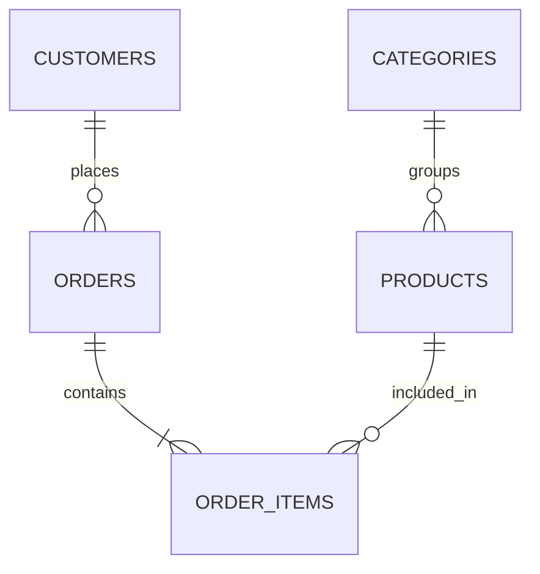

# E-Commerce SQL Analytics

A hands-on **SQL portfolio project** exploring e-commerce sales, product performance, and customer behavior using **SQLite**. The project focuses on business questions, joins, grouping, aggregations, and actionable analytics.

> **Status:** Completed — the SQL analysis exercises are solved and saved in the query files.

## What is inside?

- **1,400 customers**, **12 categories**, **240 products**, **10,000 orders**, and thousands of order items.
- Synthetic, reproducible data with an included `.db` file.
- 12 practice questions across sales, product, and customer analytics, all completed in the query files.
- Room to grow into a Power BI dashboard and an ETL pipeline.

## Database schema



See [`docs/data_dictionary.md`](docs/data_dictionary.md) for field descriptions and revenue rules.

## Quick start

You can open `database/ecommerce.db` in **DB Browser for SQLite** or a SQLite-enabled code editor.

Alternatively, with the SQLite command-line tool installed:

```bash
sqlite3 database/ecommerce.db
```

Try:

```sql
SELECT COUNT(*) AS total_orders FROM orders;
SELECT * FROM customers LIMIT 5;
```

Open and complete the exercises in `queries/`:

1. [`01_sales_overview.sql`](queries/01_sales_overview.sql)
2. [`02_product_analysis.sql`](queries/02_product_analysis.sql)
3. [`03_customer_analysis.sql`](queries/03_customer_analysis.sql)

There are no subqueries, CTEs, or window functions required for the initial challenges.

## Re-generate the dataset (optional)

Requires Python 3.9+; uses only the Python standard library:

```bash
python scripts/generate_data.py
```

**Warning:** This replaces `database/ecommerce.db` with a fresh deterministic synthetic dataset. Back up your work first if you've edited the database.

**Completed exercises:**
- [queries/01_sales_overview.sql](queries/01_sales_overview.sql)
- [queries/02_product_analysis.sql](queries/02_product_analysis.sql)
- [queries/03_customer_analysis.sql](queries/03_customer_analysis.sql)

## SQL skills covered

`SELECT` · `WHERE` · `JOIN` · `LEFT JOIN` · `GROUP BY` · `HAVING` · `ORDER BY` · `COUNT` · `SUM` · `AVG` · `CASE` · `strftime`

## Roadmap

- [x] Complete 12 SQL exercises
- [x] Save validated query results and business findings in the query files
- [ ] Add a BI dashboard screenshot to `screenshots/`
- [ ] Expand with CTEs and window functions
- [ ] Add a Python ETL process

## Data privacy

All records are **generated and fictional**. There are no real customer details or confidential records.
