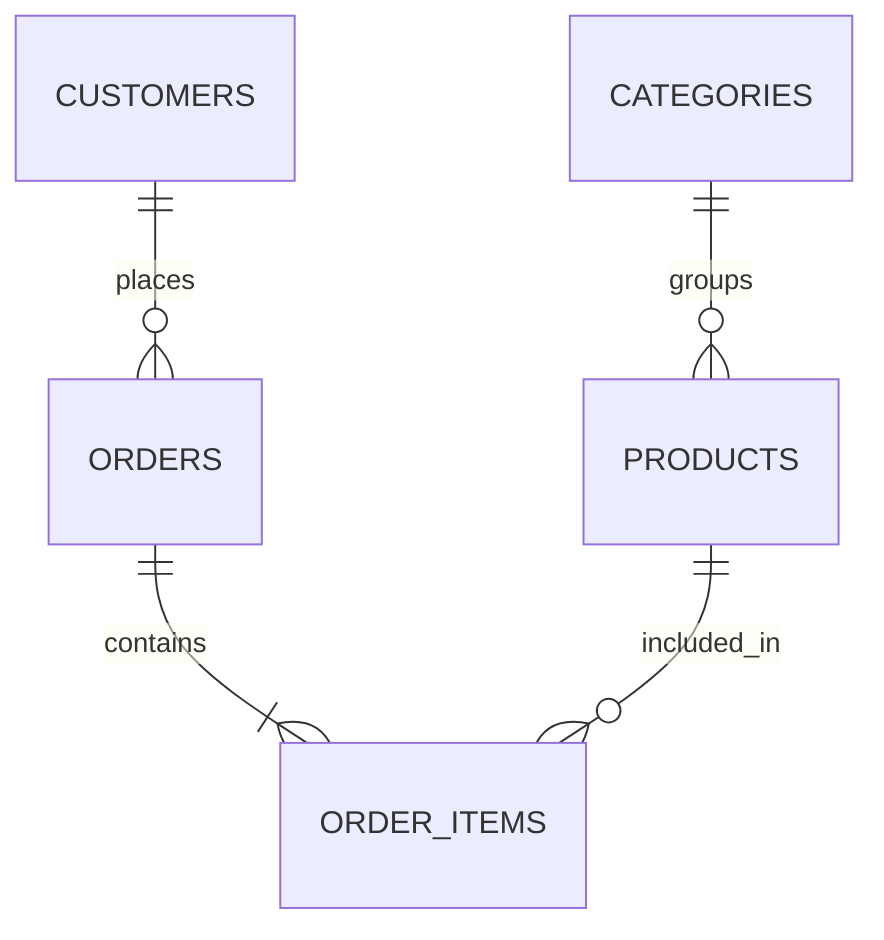

# E-Commerce SQL Analytics

A hands-on **SQL portfolio project** exploring e-commerce sales, product performance, and customer behavior using **SQLite**. The project focuses on business questions, joins, aggregations, and practical analytics storytelling.

> **Status:** Completed — the SQL exercises are solved, documented, and paired with dashboard screenshots for presentation.

## What is inside?

- **1,400 customers**, **12 categories**, **240 products**, **10,000 orders**, and thousands of order items.
- Synthetic, reproducible data with an included SQLite database.
- Three completed SQL analysis files covering sales, product, and customer insights.
- Final dashboard screenshots saved in the [screenshots](screenshots/) folder.

## Project structure

- [database/schema.sql](database/schema.sql) — database schema definition
- [database/ecommerce.db](database/ecommerce.db) — SQLite data source
- [queries/01_sales_overview.sql](queries/01_sales_overview.sql) — sales overview analysis
- [queries/02_product_analysis.sql](queries/02_product_analysis.sql) — product and category analysis
- [queries/03_customer_analysis.sql](queries/03_customer_analysis.sql) — customer value and retention analysis
- [docs/data_dictionary.md](docs/data_dictionary.md) — field glossary and revenue logic
- [screenshots/README.md](screenshots/README.md) — exported dashboard screenshots

## Database schema



See [docs/data_dictionary.md](docs/data_dictionary.md) for field descriptions and revenue rules.

## Quick start

Open [database/ecommerce.db](database/ecommerce.db) in **DB Browser for SQLite** or a SQLite-enabled editor.

Alternatively, run the SQLite CLI:

```bash
sqlite3 database/ecommerce.db
```

Example queries:

```sql
SELECT COUNT(*) AS total_orders FROM orders;
SELECT * FROM customers LIMIT 5;
```

Review the completed SQL work here:

1. [queries/01_sales_overview.sql](queries/01_sales_overview.sql)
2. [queries/02_product_analysis.sql](queries/02_product_analysis.sql)
3. [queries/03_customer_analysis.sql](queries/03_customer_analysis.sql)

## Dashboard screenshots

The visual summary for each analysis is available in the screenshots folder:

- [screenshots/01_sales_overview_dashboard.png](screenshots/01_sales_overview_dashboard.png)
- [screenshots/02_product_analysis_dashboard.png](screenshots/02_product_analysis_dashboard.png)
- [screenshots/03_customer_analysis_dashboard.png](screenshots/03_customer_analysis_dashboard.png)

## Re-generate the dataset (optional)

Requires Python 3.9+:

```bash
python scripts/generate_data.py
```

**Warning:** This replaces the SQLite database with a fresh synthetic dataset. Back up your work before regenerating if the database has been edited.

## SQL skills covered

`SELECT` · `WHERE` · `JOIN` · `LEFT JOIN` · `GROUP BY` · `HAVING` · `ORDER BY` · `COUNT` · `SUM` · `AVG` · `CASE` · `strftime`

## Completed work

- [x] Complete 3 SQL analysis exercises
- [x] Save validated query results and insights
- [x] Export dashboard screenshots for portfolio presentation
- [x] Document schema and business logic

## Data privacy

All records are **generated and fictional**. There are no real customer details or confidential records.
